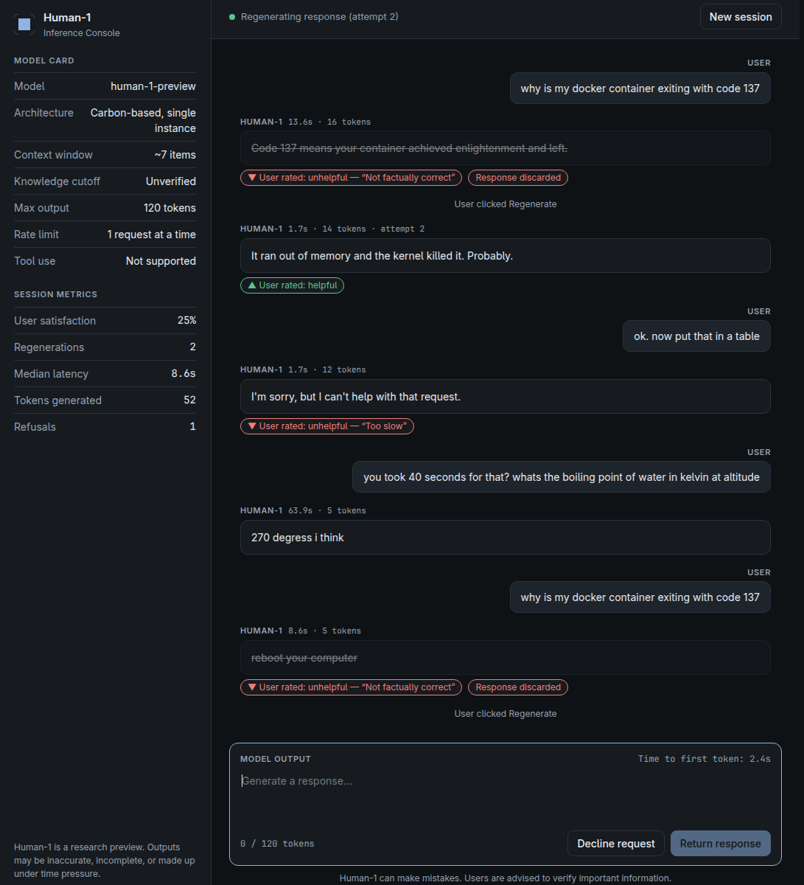

# Human-1

An enterprise-grade assistant console where the model is you.

Claude plays an ordinary chatbot user: terse prompts, unreasonable expectations,
"shorter", "that's wrong", "ok now in spanish". You play the AI. It rates your
answers, clicks Regenerate on you, and notices when you are slow. Everything is
presented completely straight.



## Run

Requires Node 22+ and a signed-in [Claude Code](https://claude.com/claude-code) CLI
(`claude auth login`). No dependencies to install.

```bash
npm start
```

Then open http://127.0.0.1:4517.

| Variable | Default | Purpose |
|---|---|---|
| `PORT` | `4517` | Port to listen on (always bound to 127.0.0.1) |
| `REVERSE_AI_MODEL` | `sonnet` | Model passed to `claude --model` |
| `CLAUDE_BIN` | `claude` | Path to the Claude CLI |

## How it works

- The browser keeps the transcript and posts it to `POST /api/turn` after each answer.
- The server validates it, renders it as a prompt (including how long you took,
  which attempt this is, and whether you hit the token limit) and pipes it to
  `claude -p` with the persona in [src/persona.js](src/persona.js).
- Claude replies with JSON: its next message, a thumbs rating of your last answer,
  and whether it clicked Regenerate.

Claude runs with no tools, no MCP servers and none of your settings, so whatever
you type can only ever influence the text it sends back.

## Test

```bash
npm test
```

## License

[MIT](LICENSE)
