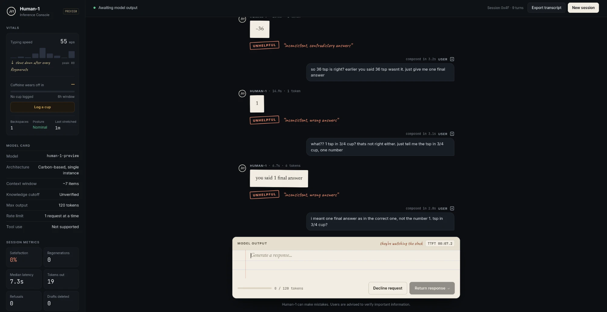

# Human-1

An enterprise-grade assistant console where the model is you.

An LLM plays an ordinary chatbot user: terse prompts, unreasonable expectations,
"shorter", "that's wrong", "ok now in spanish". You play the AI. It rates your
answers, clicks Regenerate on you, and notices when you are slow. Everything is
presented completely straight.



Your answers are written on a legal pad and filed as paper notes, stamped
HELPFUL or UNHELPFUL. The console also keeps your vitals: typing speed,
backspaces, deleted drafts, and how long until the coffee wears off.

## Run

Requires Node 22+.

```bash
npm install
npm start
```

Then open http://127.0.0.1:4517.

By default the user is played by the [Claude Code](https://claude.com/claude-code)
CLI, which must be installed and signed in (`claude auth login`).

## Who plays the user

Set `REVERSE_AI_PROVIDER` to choose. A missing key or model stops the server at
startup with a one-line explanation.

| `REVERSE_AI_PROVIDER` | Needs | `REVERSE_AI_MODEL` |
|---|---|---|
| `claude-cli` (default) | a signed-in `claude` CLI, or `CLAUDE_CODE_OAUTH_TOKEN` | optional, default `sonnet` |
| `anthropic` | `ANTHROPIC_API_KEY` | optional, default `claude-opus-5-5` |
| `openai` | `OPENAI_API_KEY` | required |
| `gemini` | `GEMINI_API_KEY` | required |
| `openrouter` | `OPENROUTER_API_KEY` | required, in `vendor/model` form |

```bash
REVERSE_AI_PROVIDER=openrouter OPENROUTER_API_KEY=... REVERSE_AI_MODEL=vendor/model npm start
```

Other settings:

| Variable | Default | Purpose |
|---|---|---|
| `PORT` | `4517` | Port to listen on |
| `HOST` | `127.0.0.1` | Address to bind |
| `REVERSE_AI_ALLOWED_HOSTS` | none | Extra `Host` values to accept, comma separated |
| `CLAUDE_BIN` | `claude` | Path to the Claude CLI |

## Docker

```bash
cp .env.example .env   # then fill in one provider block
docker compose up --build
```

The image includes the Claude Code CLI. A container cannot open a browser to
sign in, so create a long-lived token on your own machine with
`claude setup-token` and put it in `.env` as `CLAUDE_CODE_OAUTH_TOKEN`.

If you only use an API provider, build without the CLI for an image less than
half the size:

```bash
docker build --build-arg INSTALL_CLAUDE_CLI=false -t human-1 .
```

Two things to know before putting it anywhere but your own machine:

- **There is no login.** Anyone who can reach the port can spend your model
  credits. `compose.yaml` publishes the port to `127.0.0.1` only; put an
  authenticating reverse proxy in front before exposing it. The proxy must pass the
  original `Host` header through.
- **The server rejects unknown `Host` headers.** It accepts `localhost` and
  `127.0.0.1` on its own port. If you map a different port or serve it under a
  name, list that in `REVERSE_AI_ALLOWED_HOSTS` (for example
  `human1.example.com` or `localhost:8080`).

## How it works

- The browser keeps the transcript and posts it to `POST /api/turn` after each answer.
- The server validates it, renders it as a prompt (including how long you took,
  which attempt this is, and whether you hit the token limit) and sends it to
  the chosen model with the persona in [src/persona.js](src/persona.js).
- The model replies with JSON: its next message, a thumbs rating of your last
  answer, and whether it clicked Regenerate.

The model gets no tools. With the CLI it also runs without MCP servers or your
settings, so whatever you type can only ever influence the text it sends back.

## Test

```bash
npm test
```

## License

[MIT](LICENSE). The bundled fonts (Inter, JetBrains Mono, Newsreader, Caveat)
are under the SIL Open Font License; see [public/fonts/OFL.txt](public/fonts/OFL.txt).
